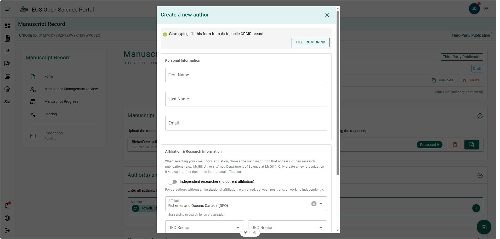

# Author and Affiliate Management

## Authors {/* #authors */}

### Create a New Author {/* #create-a-new-author */}

Create a new author if the person does not appear in the **Author List**.

**Steps**

1. Click **Can't find the author you're looking for?**.
2. Optional: click **Fill from ORCID** to fill the form from the person's public ORCID record.
    - Search by name or ORCID iD, select the matching record, review the preview, and click **Fill in the form**.
    - Only information the person made public on ORCID is filled in. Enter anything marked as not public, such as the email.
    - If the affiliation listed on ORCID is not in the OSP, choose or create it in the form.
    - Click **Use this author** if the person is already an author in the OSP.
3. Complete or review the form.
    - First Name
    - Last Name
    - Email
	- Independent researcher (Default: No)
    - Affiliation (Default: Fisheries and Oceans Canada)
	- DFO Sector
	- DFO Region
	- Emeritus Scientist (Default: No)
	- ORCID (Optional)
4. Click **Create**.

**Result**

- The author is added to the Author List.
- The author is added to the OSP author directory.

**Alternative Affiliation - Independent Researcher**
- Only toggle to True if the author is only representing themselves and is not acting on behalf of an institution.
- An ORCID iD filled from ORCID stays unverified until the author connects their own ORCID account.
- It is highly recommended that the authors ORCID be included for a more accurate and robust publication record.
- For more information, see the [Facts and Questions entry](../frequently-asked-questions.mdx#what-email-or-affiliation-do-i-use-for-an-author-who-no-longer-works-at-dfo).

### Remove an Author {/* #remove-an-author */}

Remove an author if they should no longer be associated with the manuscript.

**Steps**

1. Click the **X** icon next to the author's name.
2. Click **OK**.

**Result**

- The author is removed from the Manuscript Record Form and can no longer view or edit it.

## Affiliates {/* #affiliates */}

### Create a New Organization {/* #create-a-new-organization */}

Create a new organization if the required organization or group is not listed in the OSP **Organizations List**. This feature is typically used for Indigenous groups, long-term working groups, or organizations not already recorded in the system.

:::important
Use the organization's **official name** when creating a new record.

Official organization names can be found in the **Research Organization Registry (ROR)**:  
[Research Organization Registry](https://ror.org/)

If the organization is not listed in ROR, use the most current official name available.
:::

**Steps**

1. Click **Can't find the Organization you're looking for?**.
2. Complete the form.
    - Organization Name (English)
    - Organization Name (French)
    - Abbreviation (English) (If available)
    - Abbreviation (French) (If available) 
3. Click **Create**.

**Result**

- The organization is added to the **Organizations List** and can be selected as an **Affiliation** or **Working Group**.
