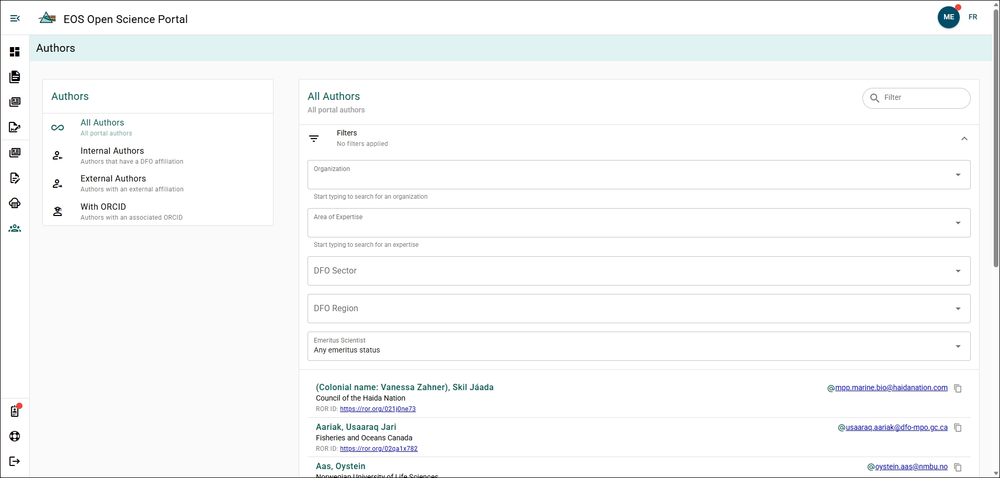

# Author Explorer

You can explore all authors who have created an account with the OSP or have been added as authors to a manuscript. By exploring an author, you can access a link to their organization's ROR page, their email address, and their ORCID (if available).

## Quick Filter {/* #quick-filter */}

Authors can be quickly filtered using the **Authors Filter Menu** on the left side of the page. The available filters are:
- All Authors
- Internal Authors
- External Authors
- Authors with ORCID

Authors can be quickly searched by name or email using the search bar on the top right side of the author list.

## Advanced Filter {/* #advanced-filter */}

Authors can be more finely filtered using the advanced filters. The advanced filter is collapsed above the Author List and can be expanded by clicking on it. The available filters are:
- Organization
- Area of Expertise
- DFO Sector
- DFO Region
- Emeritus Scientist status

