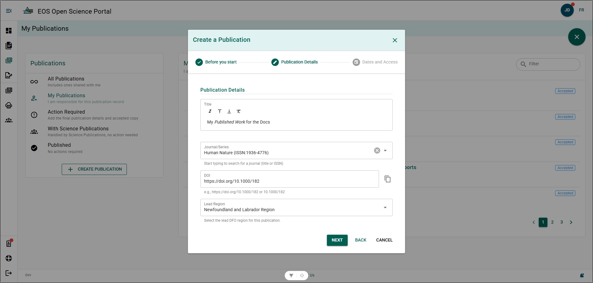

# Create a Publication Details Form

If you have published outside, or before, the OSP, creating a Publication Record for your work is an excellent way to improve its visibility within DFO and help create a centralized digital archive for documents associated with your publication.

**Steps**

1. Hover over the left-sidebar menu to expand the page selection menu.
2. Select **My Publications**.
3. Click **CREATE PUBLICATION**.
4. Click **NEXT**.
5. Complete the **Publication Details form** and Click **NEXT**.
    - Title (italic, superscript, and subscript formatting is available)
    - Journal/Series
    - DOI (Optional)
    - Lead Region
6. Complete the Publication Dates and Publication Access form and Click **CREATE**.
    - Accepted On (Optional)
    - Published On
    - Published as Open Access
    - Embargoed Until (If applicable)

**Result**

- A new Publication Details Form has been created.

