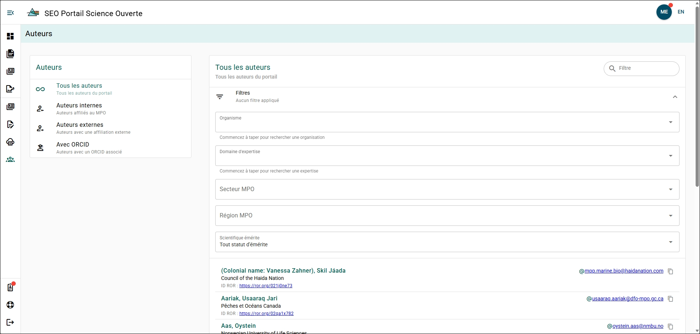

# Explorateur d’auteurs

Vous pouvez explorer tous les auteurs qui ont créé un compte dans le PSO ou qui ont été ajoutés comme auteurs à un manuscrit. En consultant le profil d’un auteur, vous pouvez accéder à un lien vers la page de son organisation dans le Research Organization Registry (ROR), à son adresse courriel et à son ORCID (si disponible).

## Filtrage rapide {/* #quick-filter */}

Vous pouvez filtrer rapidement les auteurs à l’aide du **Menu de filtrage des auteurs** situé à gauche de la page. Les filtres disponibles sont :

- Tous les auteurs
- Auteurs internes
- Auteurs externes
- Auteurs avec ORCID

Vous pouvez également rechercher rapidement un auteur par son nom ou son adresse courriel à l’aide de la barre de recherche située en haut à droite de la liste des auteurs.

## Filtrage avancé {/* #advanced-filter */}

Vous pouvez affiner davantage les résultats à l’aide des filtres avancés. La section des filtres avancés est repliée par défaut au-dessus de la liste des auteurs. Cliquez dessus pour la développer.

Les filtres disponibles sont :

- Organisation
- Domaine d’expertise
- Secteur du MPO
- Région du MPO
- Statut de scientifique émérite

