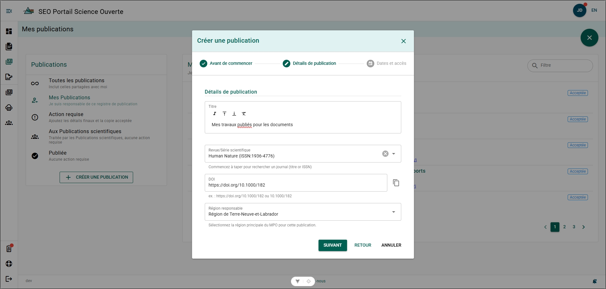

# Créer un formulaire de détails de publication

Si votre travail a été publié à l’extérieur du PSO ou avant sa mise en œuvre, la création d’un dossier de publication pour votre travail constitue un excellent moyen d’accroître sa visibilité au sein du MPO et de contribuer à la création d’archives numériques centralisées pour les documents associés à votre publication.

**Étapes**

1. Survolez le menu latéral gauche pour développer le menu de sélection des pages.
2. Sélectionnez **Mes publications**.
3. Cliquez sur **CRÉER UNE PUBLICATION**.
4. Cliquez sur **SUIVANT**.
5. Remplissez le formulaire **Détails de la publication**, puis cliquez sur **SUIVANT** :
   - Titre (la mise en forme en italique, en exposant et en indice est disponible)
   - Revue/Série
   - DOI (facultatif)
   - Région responsable
6. Remplissez le formulaire **Dates de publication et accès à la publication**, puis cliquez sur **CRÉER** :
   - Accepté le (facultatif)
   - Publié le
   - Publié en libre accès
   - Sous embargo jusqu’au (s’il y a lieu)

**Résultat**

- Un nouveau formulaire de détails de publication est créé.

