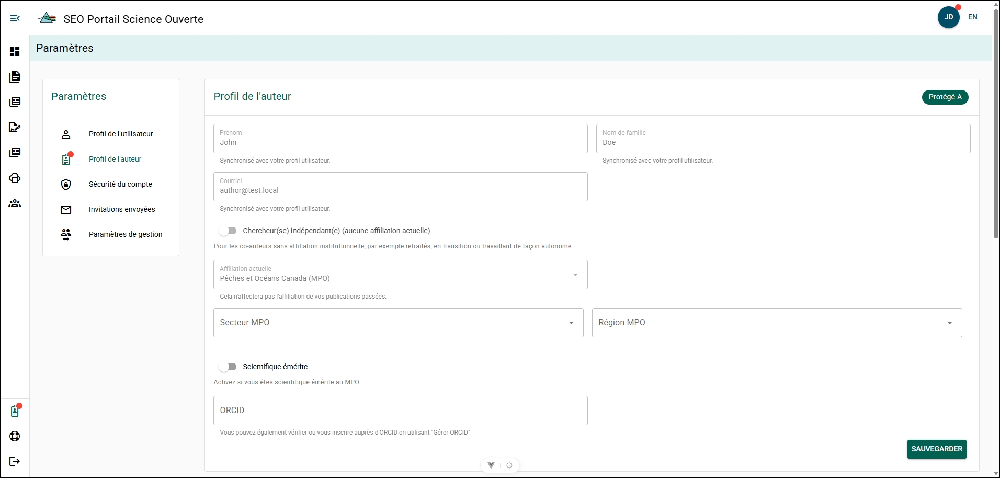
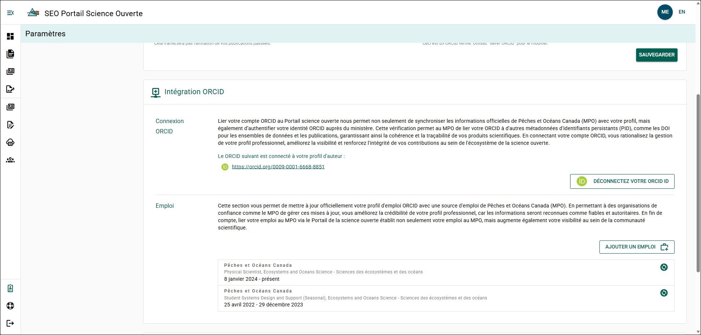
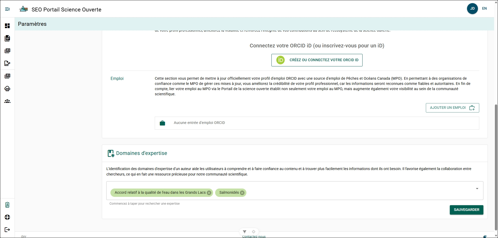
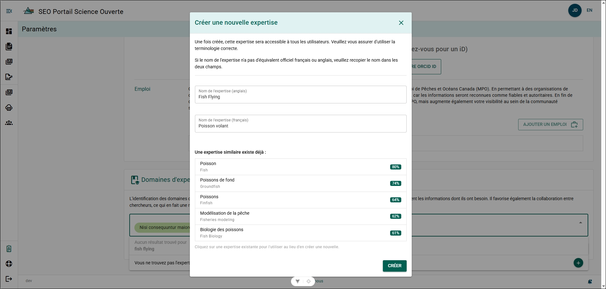

import SupportEmail from '@site/src/components/SupportEmail';

# Page Profil d’auteur

Le profil d’auteur vous permet de définir des renseignements qui faciliteront vos échanges avec d’autres chercheurs du MPO et vous aideront à maintenir votre ORCID à jour.

## Profil d’auteur {/* #author-profile */}

### Renseignements sur l’utilisateur {/* #user-information */}

Le nom et l’adresse courriel associés à votre profil d’auteur sont synchronisés à partir de votre profil d’utilisateur. Consultez la section [**Profil d’utilisateur**](./user-profile.mdx) si vous souhaitez modifier votre nom.

### Chercheur indépendant {/* #independent-researcher */}

Un chercheur indépendant est un chercheur qui se représente uniquement lui-même et qui n’agit au nom d’aucune institution.

Le PSO est accessible uniquement à partir de l’intranet du MPO. Par conséquent, votre adresse courriel et votre affiliation actuelle ne peuvent pas être modifiées. Si vous souhaitez faire créer un compte d’auteur pour une personne qui ne travaille pas au MPO, veuillez communiquer avec <SupportEmail subject="[OSP]:">**l’équipe de soutien du Portail de science ouverte**</SupportEmail>.

### Secteur et région {/* #sector-and-region */}

Pour définir ou modifier votre secteur :

**Étapes**

1. Cliquez sur **Secteur du MPO**.
2. Sélectionnez votre secteur.
3. Cliquez sur **ENREGISTRER**.

**Résultat**

- Le secteur du MPO associé à votre profil d’auteur a été défini ou mis à jour.

Pour définir ou modifier votre région :

**Étapes**

1. Cliquez sur **Région du MPO**.
2. Sélectionnez votre région.
3. Cliquez sur **ENREGISTRER**.

**Résultat**

- La région du MPO associée à votre profil d’auteur a été définie ou mise à jour.

**Informations supplémentaires**

- La modification de votre secteur ou de votre région ne changera pas les renseignements affichés sur votre fiche d’auteur dans les MRF ou les dossiers de publication existants.
- La définition de votre secteur et de votre région fera disparaître le point rouge indiquant que des mises à jour de votre profil sont en attente.

### Scientifique émérite {/* #emeritus-scientist */}

Indiquez si vous êtes scientifique émérite ou non. Cette option est désactivée par défaut.

**Étapes**

1. Cliquez sur le bouton à bascule pour modifier l’option.
2. Cliquez sur **ENREGISTRER**.

**Résultat**

- Le statut de scientifique émérite de votre profil d’auteur a été modifié.

**Informations supplémentaires**

- Lors de la création d’un compte d’auteur, l’option **Scientifique émérite** est désactivée par défaut.

### ORCID {/* #orcid */}

Si vous avez un ORCID, mais que vous **ne souhaitez pas** authentifier votre compte PSO avec ORCID, vous pouvez l’ajouter manuellement à votre profil d’auteur. Toutefois, il est fortement recommandé de connecter et d’authentifier votre compte PSO avec votre ORCID. Consultez la [**section ORCID**](../references/orcid.mdx) pour obtenir de plus amples renseignements.

**Étapes**

1. Cliquez sur **ORCID**.
2. Saisissez votre identifiant ORCID.
3. Cliquez sur **Enregistrer**.

**Résultat**

- Votre identifiant ORCID est ajouté à votre profil d’auteur.
- Un symbole ORCID non authentifié apparaît à côté de votre nom dans le PSO.

## Intégration ORCID {/* #orcid-integration */}

Le PSO permet de connecter et d’authentifier votre **Open Researcher and Contributor ID (ORCID)** avec votre compte PSO. Cette intégration permet de gérer vos dossiers ORCID par l’intermédiaire du PSO et d’y associer une source officielle du MPO.

Pour obtenir des instructions détaillées sur l’intégration ORCID et sur la façon de connecter votre compte ORCID au PSO, consultez la [**section ORCID**](../references/orcid.mdx).

## Domaines d’expertise {/* #areas-of-expertise */}

Les **Domaines d’expertise** vous permettent d’indiquer les domaines dans lesquels vous êtes un expert en la matière. L’ajout de domaines d’expertise facilite vos échanges avec d’autres auteurs.

**Étapes**

1. Cliquez sur **MODIFIER**.
2. Cliquez sur le champ **Domaines d’expertise** pour le sélectionner.
3. Saisissez votre domaine d’expertise.
4. Sélectionnez votre domaine d’expertise dans la liste filtrée.
5. Cliquez sur **ENREGISTRER**.

**Résultat**

- Le domaine d’expertise est ajouté à votre profil d’auteur.

**Informations supplémentaires**

- Vous pouvez associer plusieurs domaines d’expertise à votre profil d’auteur.

### Si votre domaine d’expertise ne figure pas dans la liste {/* #if-your-area-of-expertise-is-not-listed */}

Si votre domaine d’expertise ne figure pas dans les résultats de recherche, vous pouvez l’ajouter au PSO. Une fois créé, le domaine d’expertise devient accessible à tous les utilisateurs du PSO.

**Étapes**

1. Cliquez sur **MODIFIER**.
2. Cliquez sur le champ **Domaines d’expertise** pour le sélectionner.
3. Saisissez votre domaine d’expertise.
4. Cliquez sur **Vous ne trouvez pas l’expertise que vous recherchez? +**.
5. Saisissez le nom du domaine d’expertise en anglais et en français. Utilisez le même nom dans les deux champs de langue s’il n’existe pas d’équivalent français ou anglais.
6. Cliquez sur **CRÉER**.

**Résultat**

- Le domaine d’expertise est ajouté à votre profil d’auteur.
- Le domaine d’expertise est ajouté au PSO et est maintenant accessible aux autres auteurs.

